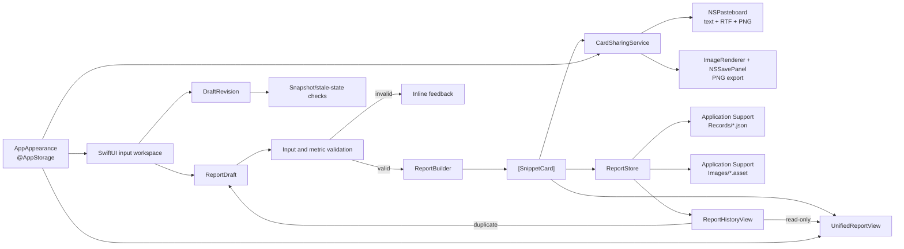

# Project Reporting Builder — Architecture

## Status and Scope

This document describes the implemented architecture on `feat/report-history`. Project Reporting Builder is a native macOS SwiftUI proof of concept that converts manually entered project information into reusable Snippet Cards and a unified report. It uses Apple platform frameworks only and has no required backend or third-party dependency.

The implementation is local-first and deterministic: it preserves user input, calculates metrics in application code, renders shareable output locally, and persists report history only when the user explicitly selects **Save Report**.

## System Overview



## Editable Input and Validation

[`ReportDraft`](../projectreportingbuilder/projectreportingbuilder/ReportDraft.swift) is the editable source of truth for:

- Project name.
- Project update text.
- Optional progress method.
- Raw percentage or milestone inputs.
- Optional progress note.
- Optional imported image.

The project name and update must contain non-whitespace content before generation is enabled. Progress is optional and represented by `ProgressMethod`:

- `none`: generate without a KPI section.
- `percentage`: validate a self-reported value from 0 through 100.
- `milestones`: validate non-negative whole-number completed and total values, require a total above zero, and reject completed values above total.

[`PercentageMetric`](../projectreportingbuilder/projectreportingbuilder/PercentageMetric.swift) and `MilestoneMetric` retain raw strings so partially entered or deliberately formatted input is not silently rewritten. Calculated progress is exposed only after validation succeeds.

[`ImageImportService`](../projectreportingbuilder/projectreportingbuilder/ImageImportService.swift) reads security-scoped file URLs, validates decoded content as PNG or JPEG, and enforces limits of 20 MB and 40 megapixels. `ImportedImage` retains the source filename and original bytes, allowing the generated report and saved history to remain independent of the original selected file.

## Deterministic Report Generation

[`ReportBuilder`](../projectreportingbuilder/projectreportingbuilder/ReportBuilder.swift) is a stateless transformation from `ReportDraft` to `[SnippetCard]`. It:

1. Creates one Summary card from the project name and update.
2. Adds one KPI/Progress card only when the selected progress input is valid.
3. Adds one Image card when an imported image exists.

It does not summarise, infer status, create missing metrics, or alter the user's narrative.

[`SnippetCard`](../projectreportingbuilder/projectreportingbuilder/SnippetCard.swift) is an enum with typed payloads:

- `summary(Summary)`
- `kpi(KPI)`, supporting percentage and milestone variants
- `image(ImageContent)`

This modular model allows the same section data to support preview, individual sharing, unified sharing, and persistence without duplicating calculation logic.

## Unified Report Composition

[`SnippetCardViews.swift`](../projectreportingbuilder/projectreportingbuilder/SnippetCardViews.swift) contains the reusable visual components. `UnifiedReportView` composes available Snippet Cards under one project title, presents Summary, Progress, and Image as report sections, and uses section dividers rather than independent outer card containers.

[`CardPreviewPanel`](../projectreportingbuilder/projectreportingbuilder/CardPreviewPanel.swift) hosts the generated report, primary report-level Copy/Export/Save controls, and secondary sharing controls for individual Snippet Cards. The preview scroll position is keyed to the generation identifier so a newly generated report returns to its header.

The editor and preview are placed in an `HSplitView` by [`ContentView`](../projectreportingbuilder/projectreportingbuilder/ContentView.swift), with minimum widths and scrollable content for window resizing.

## Clipboard and PNG Export

[`CardSharingService`](../projectreportingbuilder/projectreportingbuilder/CardSharingService.swift) owns platform-specific sharing:

- Builds readable text for individual cards and complete reports.
- Publishes plain text, RTF, and PNG together through `NSPasteboard`.
- Renders individual cards or the unified report with SwiftUI `ImageRenderer`.
- Uses a fixed 640-point render width at 2× scale for predictable PNG output.
- Applies an explicit semantic window background and opaque rendering so exported output remains readable in Light and Dark appearances.
- Preserves imported-image proportions in card and unified-report output.
- Uses `NSSavePanel` and atomic data writes for user-selected PNG export.

All clipboard representations are prepared before the system pasteboard is cleared, preventing a rendering failure from destroying existing clipboard content. Render height is bounded to prevent excessive bitmap allocation.

## Appearance

[`projectreportingbuilderApp.swift`](../projectreportingbuilder/projectreportingbuilder/projectreportingbuilderApp.swift) defines `AppAppearance` with System, Light, and Dark choices. The selected value is persisted with `@AppStorage`; System maps to no forced SwiftUI colour scheme.

Views use SwiftUI and AppKit semantic colours, with shared contrast-aware values in [`AccessibleColors.swift`](../projectreportingbuilder/projectreportingbuilder/AccessibleColors.swift). PNG rendering explicitly applies the requested Light or Dark drawing appearance rather than depending on whichever appearance happens to be active at export time.

## Generated Snapshot Consistency

Generation produces a separate array of `CardPreviewItem` values. The current editable `ReportDraft` is not used directly for sharing after generation.

[`DraftRevision`](../projectreportingbuilder/projectreportingbuilder/ContentView.swift) captures the inputs used for the last generation. When current inputs differ:

- The UI marks the preview as out of date.
- The visible generated report remains unchanged.
- Copy and Export continue to operate on the visible snapshot.
- Save Report is disabled until regeneration.

`ReportSaveEligibility` also disables repeat saving of the same generation. Duplicating a saved report replaces the editor only after any required confirmation, clears the previous generated preview, and requires the new draft to be generated before it can be shared or saved.

## Saved Reports and Local Persistence

[`SavedReport`](../projectreportingbuilder/projectreportingbuilder/SavedReport.swift) is the Codable persistence model. Each snapshot contains:

- A unique UUID.
- Project name and original update.
- Creation time.
- Optional percentage or milestone progress, including raw inputs and progress note.
- An optional managed-image reference containing the source filename and asset filename.

[`ReportStore`](../projectreportingbuilder/projectreportingbuilder/ReportStore.swift) persists reports beneath the app-specific user Application Support directory:

```text
ReportHistory/
├── Records/
│   └── <report-uuid>.json
└── Images/
    └── <report-uuid>.asset
```

One JSON file is used per report rather than one shared history index. Image bytes remain in separate managed files instead of being embedded in list records. This keeps history records small, isolates corrupt records, and allows deletion to target a single report and its exclusively owned image.

Writes use a same-directory temporary file, atomic data writing, and a move that refuses an existing destination. A failed record write cleans up a newly written image. The store lists readable records newest first and skips damaged JSON without hiding valid records.

## History Workflows

[`ReportHistoryView`](../projectreportingbuilder/projectreportingbuilder/ReportHistoryView.swift) provides:

- Newest-first browsing with project name, creation date, update excerpt, and progress.
- A read-only unified snapshot that does not replace the current editor.
- Report-level Copy and Export for the opened snapshot.
- Duplicate as New Draft through `ReportStore.draftForEditing`.
- Confirmation before replacing current unsaved editor work.
- Confirmation before deleting a record and its managed image.

`ReportStore.snapshotForViewing` degrades gracefully when an image is missing or corrupt: it returns the usable Summary and Progress cards plus an image warning. Draft duplication is stricter because an editable duplicate is expected to reproduce all saved inputs; missing or corrupt image data produces a controlled error instead of silently dropping it.

## Error Handling and Data Integrity

The design uses typed validation and localized errors at the relevant boundary:

- Invalid project or progress input prevents generation.
- Unsupported, corrupt, oversized, or inaccessible images report import errors without mutating accepted input.
- Invalid metrics never produce a KPI value.
- Clipboard and render failure feedback does not claim success.
- Export cancellation returns without writing a file or showing success.
- Invalid, missing, duplicate, or damaged saved-report data maps to `ReportStore.StoreError`.
- Record identifiers, filenames, and embedded UUIDs are cross-checked while loading.
- Deleting one report addresses only its UUID-derived record and image paths.

UI orchestration and platform services are main-actor isolated where appropriate; image decoding and deterministic model logic remain independently testable.

## Architectural Trade-offs

### Local-first persistence

Application Support plus Codable records keeps the PoC data on the device, inspectable, dependency-free, and straightforward to test with temporary directories. Per-report files offer fault isolation and avoid rewriting a global history file.

The trade-off is that this is not a synchronised multi-user store. There is no cloud sync, account model, conflict resolution, search index, or schema migration/versioning layer. Listing history scans the records directory, which is appropriate for PoC-scale data but would need reconsideration for large collections.

### Value models and direct composition

Small Swift value types and a stateless builder make calculations and transformations predictable. The UI owns limited orchestration state rather than introducing a larger view-model or database abstraction. This is efficient for the current scope, though broader editing, navigation, or concurrency requirements could justify additional layers later.

### Original image preservation

The app retains original imported bytes to preserve quality and aspect ratio across generation and saved history. This uses more local storage than recompressing assets, but avoids generational loss. Production work could add storage quotas, lifecycle management, thumbnails, and migration support.

### Deferred AI integration

AI-assisted organisation and card recommendations are intentionally not part of the implemented architecture. Manual entry or pasted updates remain the ingestion method, and deterministic metric/report generation remains independent of model availability. A future on-device AI service should produce reviewable suggestions separate from `ReportDraft`, require explicit acceptance, and remain optional so manual reporting continues to work when a model is unavailable.

## Boundaries and Future Evolution

The current architecture does not include cloud services, authentication, external project-management integrations, historical comparison charts, advanced templates, or AI output. Live VoiceOver behavior and complete keyboard navigation remain manual validation items rather than architectural guarantees.
